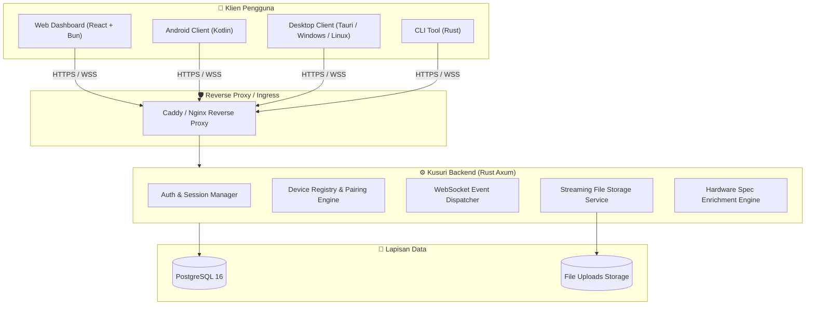

# Arsitektur Sistem Kusuri 🏛️

Kusuri adalah platform sinkronisasi multi-perangkat real-time yang dirancang dengan filosofi **keamanan berpusat pada pengguna**, **performa tinggi**, dan **kemudahan self-hosting**.

## 🌐 Gambaran Arsitektur Global

## 🔐 Model Keamanan & Identitas

1. **User Authentication**:
   - Akun pengguna dilindungi dengan password hash berstandar tinggi (**Argon2id**).
   - Sesi interaktif browser / web dashboard menggunakan **JWT (JSON Web Token)** berumur pendek.
2. **Device Authentication**:
   - Setiap perangkat terdaftar memiliki **Device Token** acak sepanjang 64 karakter dengan entropi 256-bit (`ksr_...`).
   - Server hanya menyimpan hash SHA-256 dari device token (`token_hash`), mencegah eksploitasi jika database terkompromi.
3. **Data Isolation**:
   - Seluruh event WebSocket dan rekaman database diisolasi ketat berdasarkan `user_id`. Perangkat tidak pernah dapat mendengar data milik akun lain.
