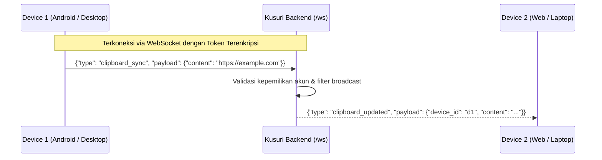

# Kusuri Shared Protocol Specification 📡

Direktori ini berisi spesifikasi kontrak komunikasi, format data serialisasi, serta skema pesan real-time WebSocket dan REST antar seluruh komponen Kusuri.

## 🎯 Tujuan

Menjaga satu sumber kebenaran (*single source of truth*) untuk format pesan jaringan, sehingga server, web dashboard, desktop, mobile, dan CLI selalu kompatibel.

## 📦 Isi yang Disarankan

1. **JSON Schemas / TypeBox / Zod definitions**:
   - `events/`
     - `clipboard_changed.json`
     - `device_online.json`
     - `device_offline.json`
     - `file_available.json`
     - `command_requested.json`
     - `command_result.json`
2. **Protocol Buffers (`.proto`)** *(Opsional untuk high-throughput binary sync)*:
   - `kusuri.proto`

## 🔄 Alur Sinkronisasi Pesan

